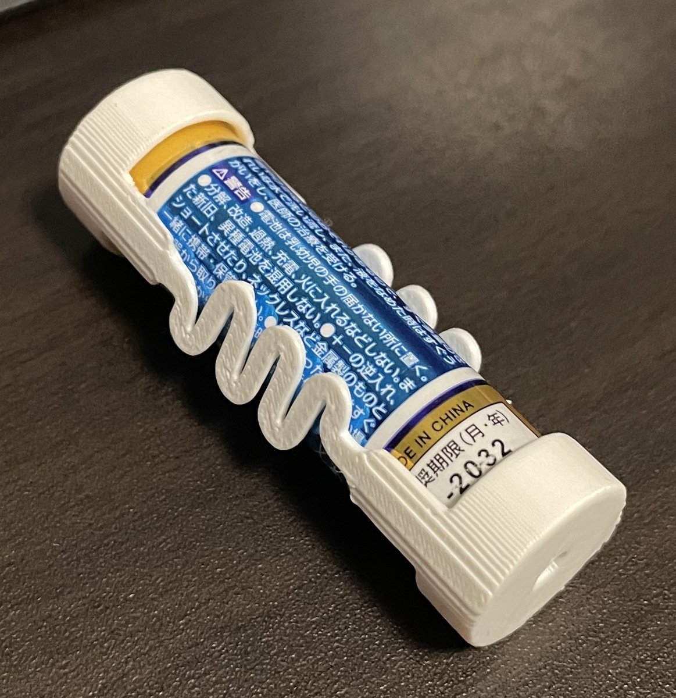

# Meander Spring Maker — 蛇行ばね 2D設計ツール

**Version 0.4.2**

[ブラウザで開く（GitHub Pages）](https://tarosay.github.io/meander_spring_maker/)

蛇行ばね（メアンダばね）1本の中心線と外形を、数値入力・スライダーで設計するブラウザツールです。設計寸法は **mm**。引張時の変形を概算表示し、**DXF** および **DesignSpark Mechanical（DSM）向けTXT** を出力します。単一の `index.html` で動作し、ビルドやサーバーを必要としません。

## 造形例

*製作例：単3電池の両端キャップをつなぐ3Dプリントの蛇行ばね。これは応用例であり、ツール自体は用途や素材を限定しません。*

## 主な機能

- **形状設計**：取付点間距離、左右幅、折り返し回数、線幅、端部長さ、厚みを設定。スライダーの変更は即時に反映。
- **折り返し方式**：180°半円弧（初期値、半径 = ピッチ/2）／90°円弧2つ＋直線（半径を指定）を選択。
- **引張プレビュー**：P0を固定し、P1をドラッグまたは引張変位を指定。荷重・ばね定数・ひずみを簡易表示。
- **CAD出力**：DXF（R12形式）とDSM用TXT。出力されるのは**変形前のばね1本**。
- **設定保存**：JSON形式で保存・復元可能。v1〜v4の設定JSONも読み込み可能。

## DesignSpark Mechanical（DSM）で3Dプリント用データを作る

1. ブラウザ上で形状を調整する。
2. **point curve (.txt) をダウンロード**し、DSMで点列を読み込む（またはDXFを読み込む）。
3. DSMで閉じた輪郭から面を作り、必要な厚みを付けて立体化する。
4. STLに書き出し、スライサーで印刷条件を設定する。

### TXT出力：Polyline の切り替え

サイト右側の **「DSM向けTXTの読み込み方式（Polyline）」** で選択します。

| 設定 | DSMでの読み込み |
|---|---|
| **True（初期値）** | 点を直線で結ぶ。直線・角を維持。円弧は短い直線の集合として近似される。 |
| False | 点列をスプライン補間。直線や角も丸まる可能性がある。 |

ダウンロードしたTXTの先頭には、選択に応じて `Polyline=True` または `Polyline=False` が出力されます。**「初期値True」であり、True固定ではありません。** 変更した設定はJSON保存にも含まれます。

DXFでは中心線の直線を `LINE`、円弧を `ARC` として出力し、線幅のある閉じた外形を点列による `POLYLINE` で出力します。**DXFの外形も厳密な円弧ではなく点列近似**です。DSMでの面作成前に交差や閉じ具合を確認してください。

## 設定値と互換性

- JSON設定の現行形式：**version 5**（`txtPolyline` は真偽値）。
- 旧version 1〜3：元の90°円弧×2方式として読み込みます。
- 旧version 4：保存された折り返し方式を維持します。
- 旧JSONにはTXT方式の記録がないため、読み込み時は **Polyline=True** を適用します。
- 「初期値に戻す」で半円弧方式／Polyline=Trueを含む全設定を初期化します。

## 変形表示の精度について

**変形・荷重・最大ひずみ・仮の許容ひずみ到達変位は、実際の伸び限界や安全性を保証しません。**

計算は小変形・線形弾性の2D梁要素モデルに基づく概算です。両端固定、材料の均一・等方性などを仮定し、大変形、層間異方性、局所応力集中、塑性変形、クリープ、疲労、座屈、自己接触、破断は評価しません。

初期の曲げ弾性率 `2,979 MPa` はELEGOO PLA+のXY方向の参考値ですが、3Dプリント品の剛性や耐久性は造形方向・温度・充填率・積層条件などで変わります。初期の仮許容ひずみ `0.5%` も安全基準ではありません。実際の用途では印刷した試験片で評価してください。

## 公開・開発

GitHub Pagesを`main`ブランチの`/(root)`から公開する場合は、`index.html`、`README.md`、`assets/`をリポジトリ直下へ配置してください。ブラウザでローカルの`index.html`を直接開いても使用できます。外部ライブラリやサーバーは不要です。

ソースはHTML・CSS・JavaScriptを`index.html`にまとめています。
